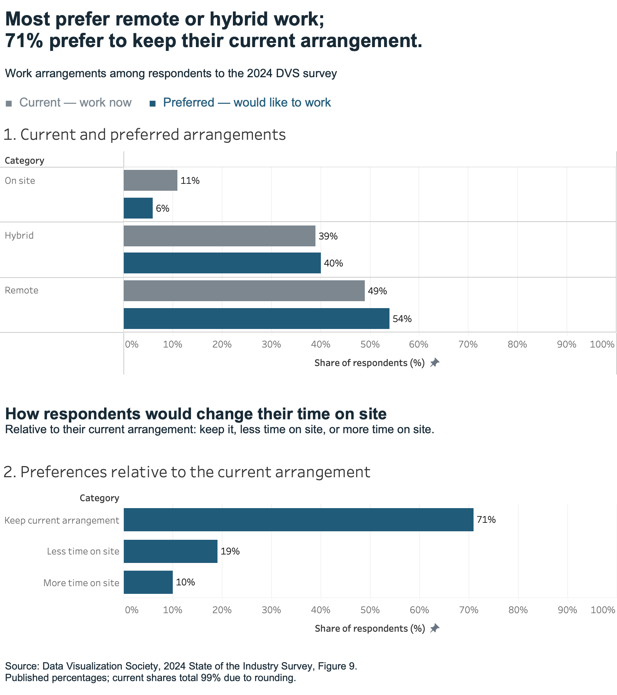

# Dingwei Bai

### Data Visualization Portfolio

[About Me](#about-me) · [What I Hope to Learn](#what-i-hope-to-learn) · [Portfolio](#portfolio)

## About Me

Hi, I’m Dingwei Bai. I’m a student interested in how data can help us understand the world and communicate ideas more clearly. Through this course, I hope to explore the connection between data, design, and storytelling.

This portfolio documents my work in Telling Stories with Data. Each project includes the visualization, the choices behind its design, and reflections on what I learned through the process.

## What I Hope to Learn

I hope to learn how to turn complex information into visualizations that are clear, engaging, and useful. I want to become more confident in choosing appropriate chart types, using color and layout effectively, and building a story around data.

I’m also interested in learning how to evaluate visualizations critically, recognize potentially misleading design choices, and improve my work through feedback and revision. After graduation, I hope to apply these skills in work that involves analyzing information, solving problems, and communicating findings to different audiences.

## Portfolio

### [Final project, Part I: Streets around campus](final-project-part-one.html)

What kinds of street maintenance issues get reported in the neighborhoods around CMU and Pitt? This proposal uses Pittsburgh's 2024 311 records to compare issue types, nearby neighborhoods, and monthly patterns. It includes the story outline, two Python storyboards, working data, and the plan for an interactive final story.

[Read the proposal](final-project-part-one.html) · [Explore the data](data/final-project/311-campus-street-issues-2024.csv)

### [Critique and redesign: Work arrangements](critique-by-design.html)

How do current work arrangements compare with what people prefer? I redesigned a figure from the Data Visualization Society's 2024 survey using paired bars and a shared percentage scale. The project documents the original critique, initial sketch, interviews and revisions, and final Tableau visualization.

[Read the project](critique-by-design.html) · [Explore the data](data/makeover-monday/chart-values.csv) · [Download the Tableau workbook](assets/makeover-monday/work-arrangements.twbx)
