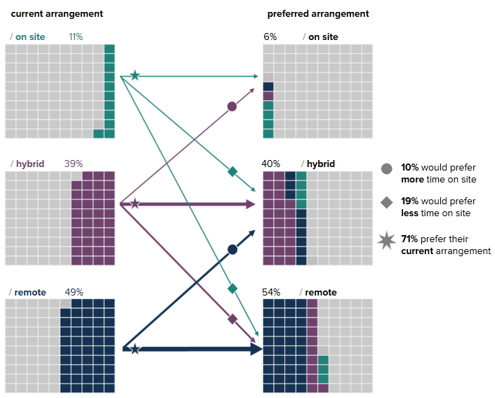
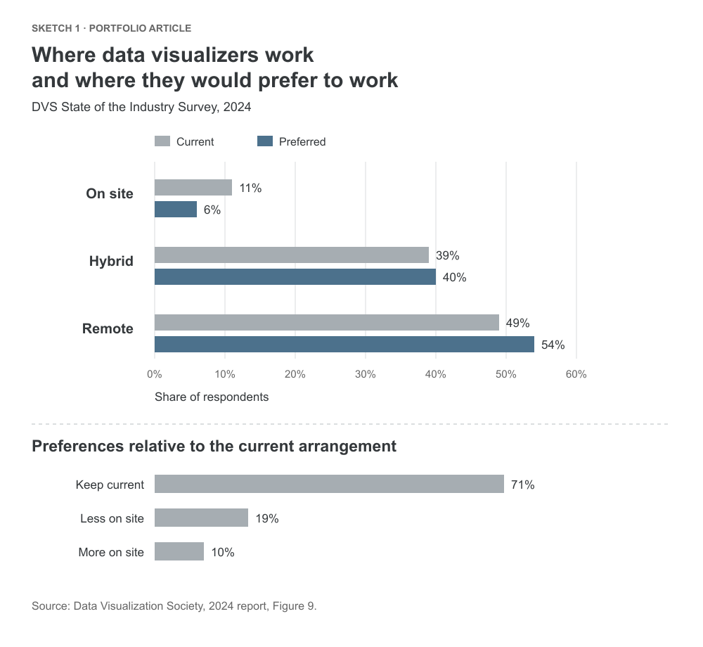

# Making work-arrangement preferences easier to compare

Dingwei Bai

[← Portfolio home](./) · [Interviews and revisions](#4-testing-and-revising) · [Data](data/makeover-monday/chart-values.csv)

## 1. Choosing the visualization

I selected Figure 9, “Current and Preferred Work Arrangements,” from the Data Visualization Society's [2024 State of the Industry Survey report](https://datavisualizationsociety.org/dvs-plus/soti-report-2024/). It appears in the [Makeover Monday archive](https://makeovermonday.co.uk/) under January 20, 2025. The original is a professional organization's published visualization, and its printed percentages can be reconstructed accurately.

I chose it because the question is easy to relate to: does where people work match where they would prefer to work? The original contains enough information to make that comparison, but I found myself reading the numbers and then tracing the arrows to work out how the pieces fit together. That made it a useful redesign exercise. My aim was to make the comparison easier to read using the published values.

*Original visualization: Data Visualization Society, 2024 State of the Industry Survey, Figure 9. [Original image](https://datavisualizationsociety.org/wp-content/uploads/2025/08/image-251.webp).*

I transcribed all nine labeled percentages into a [data file](data/makeover-monday/chart-values.csv). The current-arrangement percentages total 99%, while the other two groups total 100%. I retained the published rounded values.

## 2. Critiquing the original

I used [Stephen Few's Data Visualization Effectiveness Profile](https://www.perceptualedge.com/articles/visual_business_intelligence/data_visualization_effectiveness_profile.pdf) to consider the chart's usefulness, completeness, perceptibility, truthfulness, intuitiveness, aesthetics, and engagement. The main strength is that it shows current arrangements and preferences together. Its labels make the numbers available, and its compact layout works within a larger report.

The main difficulty is perceptibility. The reader must connect six grids, three colors, crossing arrows, different line weights, and a shape legend. The two hybrid values are almost identical, so comparing filled squares offers little help beyond the printed numbers. The chart also combines two questions: how current and preferred distributions differ, and whether respondents want more or less time on site. Separating those questions seemed more useful than simply making the arrows larger or brighter.

| Criterion | Score out of 10 | Main observation |
| --- | ---: | --- |
| Usefulness | 8 | The current/preferred comparison is relevant to the report's professional audience. |
| Completeness | 6 | Values are labeled, but the isolated image needs more context about respondents and its denominator. |
| Perceptibility | 4 | Several overlapping encodings make a quick comparison harder than necessary. |
| Truthfulness | 8 | Current and preferred values are labeled; a rounding note would clarify the 99% total. |
| Intuitiveness | 5 | Understanding the combined arrows, shapes, and grids requires consulting the legend. |
| Aesthetics | 7 | The palette and repeated grids are coherent, although the center is crowded. |
| Engagement | 6 | The topic invites interest, but the main findings compete for attention. |

The report's main audience is the data-visualization community, including practitioners, students, and managers. The topic is relevant to that audience, but even readers familiar with charts benefit from a comparison they can scan quickly. A subtitle naming the survey and its respondents also helps the figure stand on its own.

The profile made my critique more specific. A chart can be visually pleasing and still take too much effort to decode. The Good Charts framework helps with an earlier decision: what kind of communication is needed? This is a small, data-driven comparison intended to communicate a finding. I used that purpose to choose a simple form, then used Few's criteria to check it. I would also test small-screen readability, nonvisual access, and readers' understanding of the survey context.

## 3. Sketching a solution

I made a digital wireframe before building the final chart. I kept on-site, hybrid, and remote arrangements in a consistent order and placed current and preferred bars next to one another. The common starting point lets readers compare lengths without following a path across the page. A second section contains the three published preferences relative to the current arrangement.

*Initial digital wireframe, preserved before testing.*

I imagined this appearing inside a short portfolio article. The chart needed to be readable on its own, with percentages beside the bars. The critique and sketch were developed from the original visualization.

## 4. Testing and revising

### Interview questions

I asked two people to look at the initial sketch and answer three open-ended questions:

1. What do you think this chart shows?
2. Which parts are unclear or difficult to understand?
3. What change would make the chart better?

### Participant 1

**What the chart shows.** The participant understood it as a comparison of data visualization practitioners' current and preferred work arrangements. Remote work stood out at 49% current and 54% preferred. They also understood that 71% wanted to keep their current arrangement and described that as being satisfied with it.

**What was unclear.** The relationship between the upper and lower sections was unclear, including why they were separated. Less on site and More on site needed a reference point: the participant was unsure whether they referred to the current arrangement or to remote work. Current and Preferred were also not immediately clear, even with the legend.

**Suggested improvement.** The participant wanted a short takeaway so readers could grasp the message without comparing every number. They suggested: “Most people prefer remote or hybrid work, and 71% are happy with their current arrangement.” I used this idea for the final headline, with “71% prefer to keep their current arrangement” matching the survey category.

### Participant 2

**What the chart shows.** The participant understood the comparison of current and preferred work arrangements. They identified remote as the most preferred arrangement, followed by hybrid, with on-site work less common. They also recognized that most respondents, 71%, wanted to keep their current arrangement.

**What was unclear.** The participant asked how the lower values of 71%, 19%, and 10% were calculated and how they related to the three arrangements above. Less on site and More on site did not explain how much on-site time people wanted to reduce or add. The connection between the two sections was not immediately apparent.

**Suggested improvement.** The participant wanted a direct explanation of the lower section: the shares who want to keep their current arrangement, spend less time on site, or spend more time on site. This would make the relationship between the sections easier to understand.

### What I learned

Both participants understood the overall topic and recognized the preference for remote work and the 71% finding. Both wanted a clearer connection between the sections and a reference point for Less/More on site. Participant 1 emphasized a short takeaway and definitions of Current and Preferred. Participant 2 focused on what the lower percentages measured. Their comments showed that readable values alone did not explain how the parts of the chart fit together.

### From feedback to changes

| Feedback | Change | Purpose |
| --- | --- | --- |
| Participant 1 wanted a short takeaway. | Add a headline combining preference for remote or hybrid work with the 71% who want to keep their current arrangement. | Give readers the main message before they compare values. |
| Participant 1 found Current and Preferred unclear. | Expand the legend to Current — work now and Preferred — would like to work. | Explain the two series in everyday language. |
| Both participants were unsure how the sections related. | Label the lower panel as preferences relative to the current arrangement. | Establish the reference point for its categories. |
| Both asked about Less/More on site. | Explain the lower categories in a sentence above the chart and use the full labels Less time on site and More time on site. | Make the direction of the desired change explicit. |
| Participant 2 wanted to understand the lower percentages. | Explain that they summarize keeping the current arrangement or preferring less or more time on site, alongside the source link. | Help readers understand what that section measures. |

I kept the lower section's wording focused on the direction of change, following the published categories. I also retained the two-item legend, the order On site, Hybrid, Remote, and aligned 0–100% axes as design choices that support comparison.

The interviews shifted my attention from simplifying the original figure to explaining the relationship between its parts. The bars made values accessible, but the readers still needed a clear headline and reference point. Evan Peck's [Data is Personal](https://medium.com/multiple-views-visualization-research-explained/data-is-personal-what-we-learned-from-42-interviews-in-rural-america-93539f25836d) helped me consider how readers' questions and context shape their understanding of a chart.

## 5. The redesign

I revised the dashboard in Tableau Desktop after the interviews, adding the takeaway headline, definitions in the legend, and an explanation above the lower panel. The dashboard contains two worksheets. I checked all nine percentages against the transcribed data before exporting the image. Both sections use fixed 0–100% axes, with gray for current arrangements and blue for preferences.

[Download the editable Tableau workbook](assets/makeover-monday/work-arrangements.twbx) · [Open the full-size Tableau export](assets/makeover-monday/tableau-redesign.png) · [View the data](data/makeover-monday/chart-values.csv)

The workbook includes the CSV for offline use. The data contains the nine published percentages transcribed from Figure 9 and checked against the original image. The report describes an online survey circulated through DVS and related channels from September 2 to October 8, 2024.

The top panel compares where respondents work now with where they would like to work. Remote is the largest category in both distributions, and remote or hybrid work accounts for most preferences. The lower panel summarizes preferences relative to the current arrangement: 71% want to keep it, 19% want less time on site, and 10% want more time on site.

The redesign focuses on comparing the published percentages. It preserves all nine labeled values and separates the two survey questions into clear sections. The shared scale, consistent colors, and value labels help readers compare arrangements with fewer decoding steps. The original emphasizes connections between arrangements through its arrows; my version gives priority to comparing the category shares. That focus suits the short explanatory article I wanted to create.

## Sources and references

- Data Visualization Society. [2024 State of the Industry Survey report](https://datavisualizationsociety.org/dvs-plus/soti-report-2024/), Figure 9.
- Makeover Monday. [Challenge archive](https://makeovermonday.co.uk/), January 20, 2025.
- Few, Stephen. [Data Visualization Effectiveness Profile](https://www.perceptualedge.com/articles/visual_business_intelligence/data_visualization_effectiveness_profile.pdf). Perceptual Edge, 2017.
- Berinato, Scott. [Visualizations That Really Work](https://store.hbr.org/product/visualizations-that-really-work/R1606H). Harvard Business Review, June 2016.
- Peck, Evan. [Data is Personal. What We Learned from 42 Interviews in Rural America](https://medium.com/multiple-views-visualization-research-explained/data-is-personal-what-we-learned-from-42-interviews-in-rural-america-93539f25836d). May 20, 2019.
- Viégas, Fernanda, and Martin Wattenberg. [Design and Redesign](https://medium.com/@hint_fm/design-and-redesign-4ab77206cf9). March 27, 2015.

[← Portfolio home](./)
