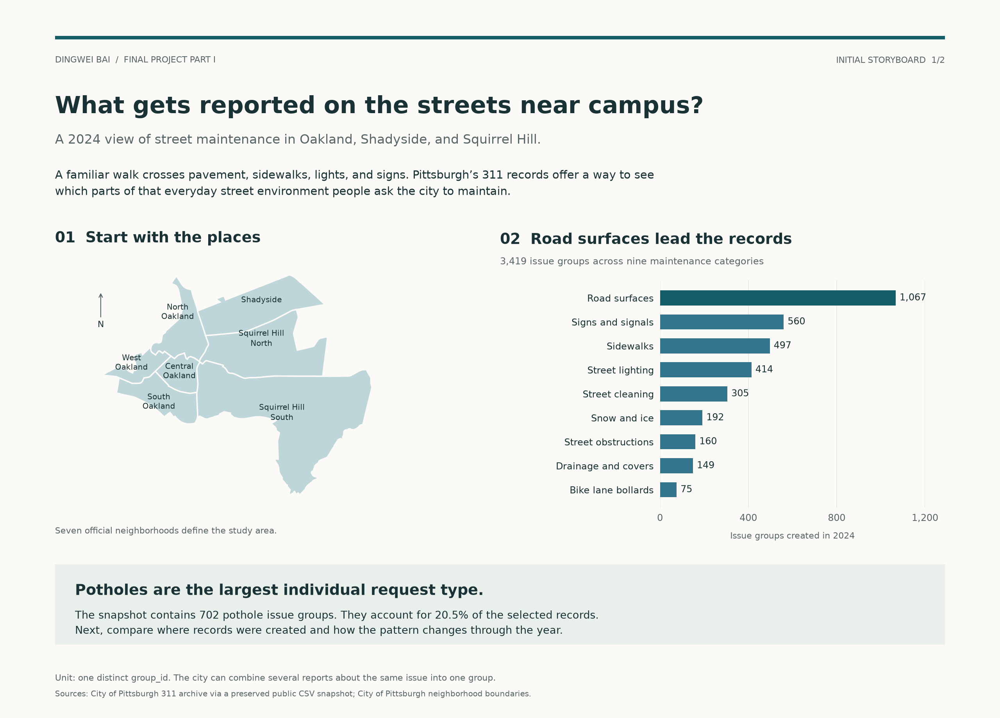
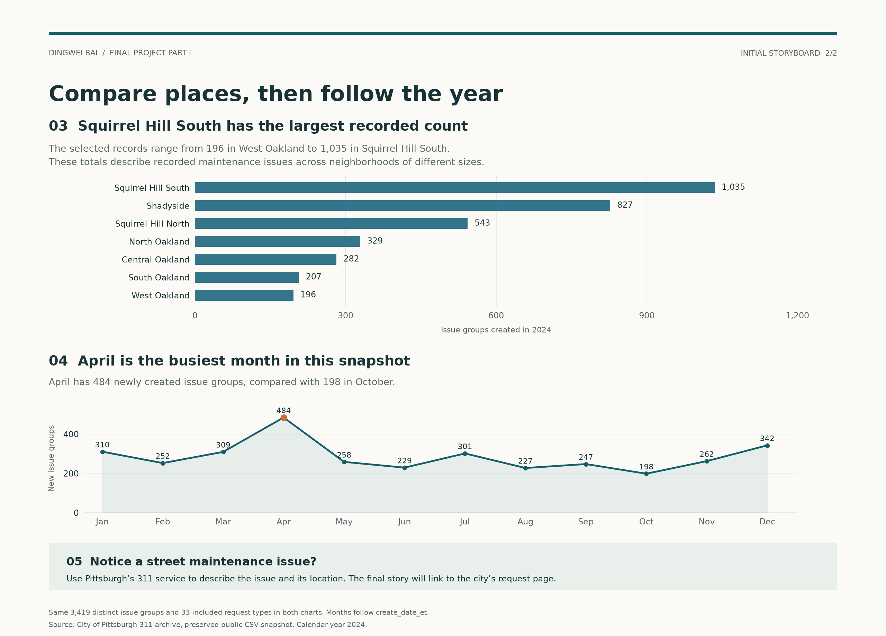

[← Back to my portfolio](index.html)

# What gets reported on the streets near campus?

**Dingwei Bai · Final project, Part I**

Street maintenance in Oakland, Shadyside, and Squirrel Hill, using Pittsburgh's 2024 311 records.

[Outline](#outline) · [Initial sketches](#initial-sketches) · [The data](#the-data) · [Method and medium](#method-and-medium) · [Sources](#sources-and-references)

## Outline

I want to explore the street maintenance issues people report in the neighborhoods around CMU and Pitt. A trip to class involves more than the road surface: sidewalks, streetlights, signs, and crossings all shape the experience. My project asks which of these issues appear most often in Pittsburgh's 311 records, how the mix differs between nearby neighborhoods, and when records were created during the year. I am focusing on 2024, a full calendar year before the city's 2025 change of 311 systems. The working dataset contains 3,419 distinct issue groups in seven neighborhoods.

The audience is students and new residents who walk, cycle, or take transit through these areas. I want readers to connect familiar places with the kinds of maintenance requests recorded there, then learn how to report an issue they notice themselves. The story will begin with a small map, move through category and neighborhood comparisons, and finish with a monthly view and a link to Pittsburgh's 311 service. In the initial analysis, road surfaces are the largest category, while potholes are the most common individual request type. These findings give the story a concrete starting point and a reason to look more closely at the other parts of the street.

**Central question:** What kinds of street maintenance issues were recorded around campus in 2024, and how did their distribution vary by place and month?

### Story structure

| Story section | What I want the reader to understand | Planned visual and interaction |
| --- | --- | --- |
| **1. Start with the places** | The study covers Central, North, South, and West Oakland; Shadyside; and Squirrel Hill North and South. | A locator map with neighborhood names and a short introduction to 311. |
| **2. Road surfaces lead the records** | Road surfaces account for 1,067 of the 3,419 selected issue groups. Within that category, potholes account for 702. | A sorted horizontal bar chart of nine maintenance categories. A selection reveals the original request types within a category. |
| **3. Look at your neighborhood** | The total and the composition of recorded issues differ between neighborhoods. Squirrel Hill South has 1,035 groups; Shadyside has 827. | A sorted neighborhood comparison. Selecting a neighborhood updates the category view and shows counts and shares within that neighborhood. |
| **4. Follow the year** | The number of newly created groups varies by month, with a high of 484 in April and a low of 198 in October. | A monthly line chart with a category selector, keeping January through December in order. |
| **5. Notice and report** | A reader can use the same reporting system to describe a street maintenance issue and its location. | A short closing paragraph and a clearly labeled link to the city's 311 request options. |

The neighborhood section will make room for a comparison beyond the overall totals. For example, the sidewalk category accounts for 197 of Shadyside's 827 selected records, or 23.8%, compared with 105 of Squirrel Hill South's 1,035 records, or 10.1%. Showing both the counts and the shares will help readers see how the mix changes across places.

## Initial sketches

I made these two storyboards in Python with Matplotlib using the working data. They show the proposed reading order, headings, explanatory text, and initial chart choices. The images are static sketches for the later interactive story.

### Sketch 1: Introduce the area and the main comparison

The map establishes the geographic scope before the reader reaches the numbers. Its single fill color identifies the study area. The bars share a zero baseline and include direct labels so readers can compare categories quickly. The pothole callout connects the broader road-surface category to a recognizable everyday issue.

### Sketch 2: Compare neighborhoods, follow the year, and close with an action

The neighborhood chart continues the category overview with a place-based comparison. The line chart then adds time, with every month shown on the same scale. Blue and teal carry the data throughout the story; orange draws attention to April's peak. The closing section directs readers to [Pittsburgh's 311 reporting options](https://www.pittsburghpa.gov/Resident-Services/311/Contacting-311).

For the final version, I plan to add neighborhood and category selection to these comparisons. The short explanations will stay beside their charts, and the initial view will still tell the story before a reader changes a filter.

## The data

My primary source is the City of Pittsburgh's [311 Data Archive, published by WPRDC](https://data.wprdc.org/dataset/311-data). The city collects service requests through several channels, including phone calls, online forms, and its mobile app. I obtained the archived records from the raw CSV preserved in [this fixed version of a public repository](https://github.com/deborahchen233/pittsburgh-311-project/blob/1cf19a78b5ad6af53c29dc8884915f4e7400b584/pittsburgh_311_raw.csv.zip), whose source documentation identifies the WPRDC archive. I accessed the snapshot on November 18, 2026. My working copy retains the selected source records, and the figures describe that fixed snapshot.

I will use the request type to compare maintenance categories, the assigned neighborhood to compare places, and the Eastern Time creation date to compare months. The source snapshot contains 98,703 records created in 2024, including 12,008 in the seven selected neighborhoods. Applying the street-maintenance classification below leaves 3,419 records across all 12 months. There are no duplicate `group_id` values in this working copy. I preserved the original request names and identifiers alongside my category labels so each grouping can be traced back to its source.

A record represents an issue group. As explained in the city's [311 Data User Guide](https://docs.google.com/document/d/1yi0Gmru3ggM72vRd-ECuvfrD77Tx-HUR6W5Hkd_bLJ4/edit), the system can combine several requests about the same problem into one group. Each chart counts distinct `group_id` values. The monthly chart assigns a group to the month in `create_date_et`. The source field `num_requests` is retained as the accumulated number of requests associated with a group. Reporting activity depends on both maintenance needs and people's use of 311, so the comparisons describe recorded issues across neighborhoods of different sizes.

The locator map uses the City's [official neighborhood boundaries](https://data.wprdc.org/dataset/neighborhoods2), downloaded from its ArcGIS service on November 18, 2026. I retained the seven selected polygons and their neighborhood names in a GeoJSON file. The map uses those boundaries for orientation, while the neighborhood comparisons use the neighborhood already assigned to each 311 record.

### Working data files

| File | Contents and use |
| --- | --- |
| [Street maintenance records, 2024](data/final-project/311-campus-street-issues-2024.csv) | 3,419 rows used in all sketches, with source identifiers, request types, creation dates, neighborhoods, and the derived category and month. |
| [Request-type classification](data/final-project/issue-category-map.csv) | The 33 included request types and their assignment to nine categories. |
| [Study-area boundaries](data/final-project/study-area.geojson) | Seven official neighborhood polygons for the locator map. |

### Selection and preparation

1. Select records with `create_date_et` from January 1, 2024, inclusive, to January 1, 2025, exclusive.
2. Keep Central Oakland, North Oakland, South Oakland, West Oakland, Shadyside, Squirrel Hill North, and Squirrel Hill South.
3. Keep the 33 request types listed below. The scope covers existing street infrastructure, surface maintenance, cleaning, snow, drainage, and physical obstructions. Parking enforcement, new signs or signals, general property complaints, and broad categories without a clear street-maintenance meaning are outside this selection.
4. Map each source request type to one category, derive the calendar month from `create_date_et`, and count each `group_id` once. All views use this same selection.

### Category definitions

These nine categories are my presentation groupings. The request names below are the original source labels.

| Category | Included request types | Issue groups |
| --- | --- | ---: |
| Road surfaces | Potholes; Road; Paving Request; Paving Concern/Problem; Utility Cut - Other; Utility Cut - PWSA; Concrete Slab Repair; Brick or Block Repair; Sinkhole | 1,067 |
| Signs and signals | Replace/Repair a Sign; Traffic or Pedestrian Signal, Repair; Pedestrian Signal Maintenance; Crosswalk and Street Markings, Maintenance; Curb Paint, Maintenance | 560 |
| Sidewalks | Broken Sidewalk; Blocked or Closed Sidewalks; Sidewalk/Curb/ADA Ramp Maintenance; Sidewalk has Ice or Litter | 497 |
| Street lighting | Street Light - Repair | 414 |
| Street cleaning | Street Cleaning/Sweeping; Leaves/Street Cleaning | 305 |
| Snow and ice | Snow/Ice removal; Sidewalk, Lack of Snow/Ice Removal | 192 |
| Street obstructions | Street Obstruction/Closure; Barricades; Tree Fallen Across Sidewalk; Tree Fallen Across Road | 160 |
| Drainage and covers | Catch Basin, Clogged; Collapsed Catch Basin; Manhole Cover; Manhole Covers, PWSA; Missing Grate | 149 |
| Bike lane bollards | Bike Lane Bollard | 75 |

## Method and medium

I plan to build a standalone scrolling story in Shorthand, with interactive charts published through Tableau Public and embedded beside the relevant text. Python is my tool for preparing the data, checking counts, and making the initial sketches. In Tableau, I will use distinct counts of `group_id`, let readers select a neighborhood or category, and show the active selection in chart titles. The map will introduce the area, while the ranked bars and monthly line will carry the main comparisons. I will check the finished story on a laptop and a phone, make sure labels remain readable, and provide the data downloads and source links at the end. The project page in this portfolio will link to the finished story as it develops.

## AI acknowledgement

I used GPT to organize the data, classify the request types in the Category definitions section, and help write the Python code used to create the sketches.

## Sources and references

- City of Pittsburgh. *311 Data Archive*. Western Pennsylvania Regional Data Center. [Dataset and documentation](https://data.wprdc.org/dataset/311-data). Accessed November 18, 2026.
- City of Pittsburgh and WPRDC. *City of Pittsburgh 311 Data User Guide*. [Guide](https://docs.google.com/document/d/1yi0Gmru3ggM72vRd-ECuvfrD77Tx-HUR6W5Hkd_bLJ4/edit). Accessed November 18, 2026.
- deborahchen233. *pittsburgh_311_raw.csv.zip*, a preserved copy of the City/WPRDC source data. [File at commit `1cf19a7`](https://github.com/deborahchen233/pittsburgh-311-project/blob/1cf19a78b5ad6af53c29dc8884915f4e7400b584/pittsburgh_311_raw.csv.zip). Accessed November 18, 2026.
- City of Pittsburgh. *Neighborhoods*. [WPRDC catalog](https://data.wprdc.org/dataset/neighborhoods2) and [City ArcGIS layer](https://services1.arcgis.com/YZCmUqbcsUpOKfj7/arcgis/rest/services/PGHWebNeighborhoods/FeatureServer/0). Accessed November 18, 2026.
- City of Pittsburgh. *Contacting 311*. [Reporting options](https://www.pittsburghpa.gov/Resident-Services/311/Contacting-311). Accessed November 18, 2026.

[← Back to my portfolio](index.html)
